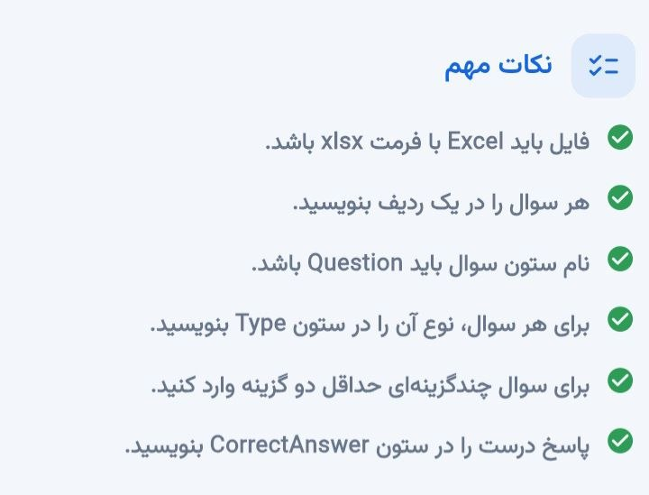

<div align="center">


# EduExan

### Class Management and Student Evaluation System

**EduExan** is an Android application built with Flutter for managing classes,
organizing student rosters, importing Excel questionnaires, recording evaluations,
and exporting the results as formatted Excel workbooks.

[](https://flutter.dev)
[](https://dart.dev)
[](https://github.com/ehnoori/EduExan)
[](https://github.com/ehnoori/EduExan/releases)
[](#license)

[**GitHub Repository**](https://github.com/ehnoori/EduExan)
&nbsp;·&nbsp;
[**Report an Issue**](https://github.com/ehnoori/EduExan/issues)
&nbsp;·&nbsp;
[**English Brochure**](./EduExam-Brochure-English.pdf)

</div>

---

## Table of Contents

- [Overview](#overview)
- [Application Screenshots](#application-screenshots)
- [Key Features](#key-features)
- [Evaluation and Data Flow](#evaluation-and-data-flow)
- [Supported Question Types](#supported-question-types)
- [Excel Questionnaire Format](#excel-questionnaire-format)
- [Excel Export Format](#excel-export-format)
- [Technology Stack](#technology-stack)
- [Project Structure](#project-structure)
- [Requirements](#requirements)
- [Installation and Setup](#installation-and-setup)
- [Running the App](#running-the-app)
- [Testing](#testing)
- [Building an Android Release](#building-an-android-release)
- [Data Storage and Privacy](#data-storage-and-privacy)
- [Troubleshooting](#troubleshooting)
- [Brochures and Documentation](#brochures-and-documentation)
- [Contributing](#contributing)
- [Developer](#developer)
- [License](#license)

---

## Overview

EduExan is a local-first, Persian-language class management application developed for
teachers and educators who need to conduct and record written evaluations. It combines
class and student administration with Excel-based questionnaires and Excel result exports.

The application does not require a server or internet connection for its core workflow.
Classes, students, evaluations, active questions, and imported question banks are stored
locally on the Android device. The README documents Android as the supported and tested
target; other platforms are generated as Flutter targets but have not been verified.

### Typical Use Cases

- Managing several classes and their teacher information.
- Maintaining a separate student roster for each class.
- Importing a reusable questionnaire from an `.xlsx` workbook.
- Previewing, selecting, and activating question banks.
- Recording one evaluation per student in each class.
- Preserving the exact questions used in previous evaluations.
- Exporting, opening, and sharing class result workbooks.

---

## Application Screenshots

The following screenshots are stored inside the repository under
[`assets/images/`](./assets/images/).

<div align="center">

| Class Management | Class Details | Question Types | Excel Import Guide |
|:---:|:---:|:---:|:---:|
|  |  |  |  |

</div>

---

## Key Features

### Class Management

- Create a class with a name and teacher name.
- Optionally record a class start and end time.
- View all saved classes in a centralized list.
- Edit and delete existing classes.
- Add and remove students from an individual class roster.
- Prevent duplicate student names within the same class.
- Keep class data isolated by the class ID.

### Student Evaluation

- Open a class and select a student who has not yet been evaluated.
- Display questions one at a time.
- Move between questions while recording answers.
- Require a response to every question before saving an evaluation.
- Prevent the same student from receiving two evaluations in one class.
- Automatically prevent saving from a student-selection screen after evaluation.
- Store each evaluation together with its date and question snapshot.
- Preserve past evaluation data even if the active questionnaire changes.

### Excel Question Banks

- Select an `.xlsx` file from the device.
- Read questions from the first worksheet.
- Preview imported questions before activating a bank.
- Save multiple question banks on the device.
- Review a bank name and number of questions.
- Activate a bank for all new evaluations.
- Delete an imported bank that is no longer needed.
- Display a built-in import guide.
- Open a bundled sample Excel workbook for reference.

### Supported Question Answers

- **Choice:** choose one option from at least two available options.
- **Number:** enter a numeric response.
- **Text:** enter a written response.
- **Project:** answer with **Yes** or **No**; a project name is required for **Yes**.

### Results and Excel Files

- Export class results after at least one evaluation has been saved.
- Include class metadata such as class name and export date.
- Include total student count, evaluated count, and unevaluated count.
- Include student numbers and names.
- Add a separate answer column for every question.
- Open the generated workbook with an installed Excel-compatible application.
- Share the workbook through Android sharing.
- Delete generated result workbooks from the app.

### User Interface

- Persian (Dari) right-to-left interface direction.
- Vazirmatn typography provided by Google Fonts.
- Onboarding flow for first-time users.
- Splash screen and guided navigation.
- Local feedback through dialogs and notifications.

---

## Evaluation and Data Flow

1. **Create a class**
   - Enter the class name and teacher name.
   - Optionally enter the class time.

2. **Add the student roster**
   - Add each student to the class.
   - Duplicate names in the same class are rejected.

3. **Import or select a question bank**
   - Open the question-import screen and select an `.xlsx` workbook.
   - Preview the parsed rows and question types.
   - Activate the desired question bank.

4. **Select an unevaluated student**
   - Open the class and open the student-selection screen.
   - Students with existing evaluations are not available for re-evaluation.

5. **Answer the questionnaire**
   - Questions are shown one at a time.
   - For project questions, enter a project name when **Yes** is selected.
   - Every question must have an answer before saving.

6. **Save the evaluation**
   - Student name, answers, date, class ID, and question snapshot are saved locally.
   - The evaluation remains unchanged if the active question bank is replaced later.

7. **Export and share results**
   - Generate an `.xlsx` result workbook for the class.
   - Open or share the file from the Excel files screen.

> EduExan records student responses; it does not automatically assign grades or calculate
> a final score. The `correctAnswer` column is accepted during workbook parsing and is
> preserved as question metadata, but the current evaluation workflow does not use it as
> an automatic grading engine.

---

## Supported Question Types

| Type value | Behavior | Required fields |
|---|---|---|
| `choice` | Multiple-choice question | Question, at least two options, correct/sample answer |
| `number` | Numeric answer entry | Question, correct/sample answer |
| `text` | Free-text answer entry | Question, correct/sample answer |
| `project` | Yes/No answer; project name is required for Yes | Question, correct/sample answer |

If the `Type` column is absent or empty, the parser treats the question as `text`.
Type values should be written in lowercase: `choice`, `number`, `text`, or `project`.

---

## Excel Questionnaire Format

Import a workbook with the `.xlsx` extension. EduExan reads the **first worksheet** and
expects one question per row. The first row must contain column headers.

A bundled example is available at:

- [`assets/files/eduexam_sample_questions.xlsx`](./assets/files/eduexam_sample_questions.xlsx)

### Required and Optional Columns

| Column | Required | Description |
|---|:---:|---|
| `Question` | Yes | Question text |
| `Type` | No | `choice`, `number`, `text`, or `project`; defaults to `text` |
| `Option A` | Choice only | First choice; aliases include `گزینه A` and `گزینه الف` |
| `Option B` | Choice only | Second choice; aliases include `گزینه B` and `گزینه ب` |
| `Option C` | Optional | Third choice; aliases include `گزینه C` and `گزینه ج` |
| `Option D` | Optional | Fourth choice; aliases include `گزینه D` and `گزینه د` |
| `CorrectAnswer` | Yes | Correct/sample answer, or a choice label such as `A` |

### Supported Header Aliases

The parser supports English and Persian/Dari-style headers:

| Purpose | Accepted examples |
|---|---|
| Question | `Question`, `سوال`, `سؤال` |
| Type | `Type`, `نوع`, `نوع سوال`, `نوع سؤال` |
| Correct answer | `CorrectAnswer`, `Correct Answer`, `پاسخ درست`, `پاسخ صحیح` |
| Choice A | `Option A`, `OptionA`, `گزینه A`, `گزینه الف` |
| Choice B | `Option B`, `OptionB`, `گزینه B`, `گزینه ب` |
| Choice C | `Option C`, `OptionC`, `گزینه C`, `گزینه ج` |
| Choice D | `Option D`, `OptionD`, `گزینه D`, `گزینه د` |

Header normalization removes Unicode byte-order marks, converts Persian/Arabic letter
variants, replaces underscores and repeated whitespace, and compares headers without case.

### Example Workbook Rows

| Question | Type | Option A | Option B | Option C | Option D | CorrectAnswer |
|---|---|---|---|---|---|---|
| The capital of Afghanistan is which city? | choice | Kabul | Herat | Kandahar | Mazar | A |
| What is 12 + 8? | number | | | | | 20 |
| Why is education important? | text | | | | | Increase knowledge |
| Is the project ready? | project | | | | | Yes |

### Import Validation

The importer rejects or skips rows according to these rules:

- A workbook must contain a header row and at least one question row.
- The question and correct-answer columns must exist.
- Completely empty question and answer rows are ignored.
- A question with text in the question column cannot have an empty answer.
- Unsupported question types are rejected.
- Choice questions must contain at least two non-empty options.

---

## Excel Export Format

The export service creates a formatted workbook named for the class and stores it in the
application documents directory.

The workbook contains:

- A Persian title section.
- Class name.
- Total number of class members.
- Number of evaluated and unevaluated students.
- Maximum recorded question count.
- Export date and time.
- Student number and name.
- One answer column for each question.
- `-` for an unanswered or unavailable result cell.

When an exported file is regenerated, EduExan writes a new workbook for the current class
evaluations and records it in the app's local Excel file list.

---

## Technology Stack

| Technology | Purpose |
|---|---|
| [Flutter](https://flutter.dev) | Cross-platform application framework |
| [Dart](https://dart.dev) | Application programming language |
| [Isar](https://isar.dev) | Local object database |
| [excel_plus](https://pub.dev/packages/excel_plus) | Reading and writing `.xlsx` files |
| [file_picker](https://pub.dev/packages/file_picker) | Selecting Excel workbooks |
| [path_provider](https://pub.dev/packages/path_provider) | Application document storage paths |
| [shared_preferences](https://pub.dev/packages/shared_preferences) | Onboarding state |
| [open_filex](https://pub.dev/packages/open_filex) | Opening generated files |
| [share_plus](https://pub.dev/packages/share_plus) | Android file sharing |
| [google_fonts](https://pub.dev/packages/google_fonts) | Vazirmatn and Google typography |
| [universal_document_viewer](https://pub.dev/packages/universal_document_viewer) | Viewing the bundled sample workbook |
| [syncfusion_flutter_pdf](https://pub.dev/packages/syncfusion_flutter_pdf) | PDF and document support |

---

## Project Structure

```text
EduExan/
├── android/                         # Android native project
├── assets/
│   ├── files/
│   │   └── eduexam_sample_questions.xlsx
│   └── images/                      # Screenshots and application images
├── lib/
│   ├── database/
│   │   └── isar_service.dart        # Isar initialization and data operations
│   ├── models/
│   │   ├── class_model.dart         # Class and student roster model
│   │   ├── evaluation_model.dart    # Evaluation, answers, and snapshot model
│   │   └── question_model.dart      # Question and answer metadata model
│   ├── onboarding/
│   │   └── onboarding_screen.dart
│   ├── screens/
│   │   ├── class_list_screen.dart
│   │   ├── class_management_screen.dart
│   │   ├── evaluation_screen.dart
│   │   ├── excel_files_screen.dart
│   │   ├── home_screen.dart
│   │   ├── import_questions_screen.dart
│   │   ├── question_import_guide_screen.dart
│   │   ├── sample_excel_viewer_screen.dart
│   │   └── student_selection_screen.dart
│   ├── services/
│   │   ├── excel_export_service.dart
│   │   └── question_import_parser.dart
│   ├── splash/
│   │   └── splash_screen.dart
│   ├── styles/
│   │   ├── class_form_style.dart
│   │   └── excel_export_style.dart
│   └── main.dart
├── test/
│   ├── question_import_parser_test.dart
│   └── widget_test.dart
├── EduExam-Brochure-*.html
├── EduExam-Brochure-*.pdf
├── pubspec.yaml
├── pubspec.lock
└── README.md
```

---

## Requirements

- Flutter SDK with Dart 3.13.2 or newer
- Android Studio or another Flutter-compatible IDE
- Android SDK and an emulator or physical Android device
- Git

Verify the available tools:

```bash
flutter doctor -v
flutter --version
```

---

## Installation and Setup

### 1. Clone the Repository

```bash
git clone https://github.com/ehnoori/EduExan.git
cd EduExan
```

### 2. Get Flutter Packages

```bash
flutter pub get
```

### 3. Confirm a Device Is Available

```bash
flutter devices
```

### 4. Run the App

```bash
flutter run
```

To select a specific attached device:

```bash
flutter run -d <device-id>
```

---

## Running the App

For a debug build on an Android device or emulator:

```bash
flutter run
```

For a profile build used for performance inspection:

```bash
flutter run --profile
```

For a release build:

```bash
flutter run --release
```

---

## Testing

Run all configured Flutter tests:

```bash
flutter test
```

Run the focused questionnaire parser tests:

```bash
flutter test test/question_import_parser_test.dart
```

Run the static analyzer:

```bash
flutter analyze
```

Format the Dart source:

```bash
dart format lib test
```

The parser test suite covers:

- Parsing all four question types.
- Legacy workbooks without a `Type` column.
- Rejection of choice questions with fewer than two options.

---

## Building an Android Release

### APK

```bash
flutter build apk --release
```

The release APK is generated under:

```text
build/app/outputs/flutter-apk/app-release.apk
```

### App Bundle

```bash
flutter build appbundle --release
```

The app bundle is generated under:

```text
build/app/outputs/bundle/release/app-release.aab
```

Before publishing, verify the package name, app label, app icon, signing configuration,
permissions, and Android manifest in [`android/app/`](./android/app/).

---

## Data Storage and Privacy

EduExan uses local device storage:

- **Isar database:** classes, students, evaluations, and active question records.
- **Application documents directory:** question-bank files and generated `.xlsx` workbooks.
- **Question bank manifest:** a JSON manifest used to list saved banks.
- **Active bank marker:** stores the ID of the currently active question bank.
- **Shared preferences:** stores onboarding state.

EduExan does not provide cloud accounts, database synchronization, server uploads, or
automatic remote backups in the current implementation. Uninstalling or clearing app data
can remove local classes, evaluations, imported banks, and exported files.

No `.env` secrets or remote API credentials are required for the core workflow.

---

## Troubleshooting

### No Questions Are Available

Import an Excel workbook or activate an existing question bank. Each evaluation requires
at least one valid question.

### A Student Is Missing from the Evaluation List

A student is excluded after a saved evaluation for that class. Existing evaluations
cannot be overwritten through the normal evaluation workflow.

### A Choice Question Is Not Imported

Confirm that:

- The question has a `choice` type.
- At least two option cells contain text.
- The correct-answer cell contains a label such as `A`, `B`, `C`, or `D`.

### The Workbook Cannot Be Opened

Install or enable an Excel-compatible Android app that can open `.xlsx` files, then use
**Open** from the Excel files screen.

### Dependencies Cannot Be Resolved

Run:

```bash
flutter clean
flutter pub get
```

Then verify the Android SDK and Flutter configuration with:

```bash
flutter doctor
```

---

## Brochures and Documentation

Brochure versions are available in the repository:

| Language | HTML | PDF |
|---|---|---|
| English | [View HTML](./EduExam-Brochure-English.html) | [Download PDF](./EduExam-Brochure-English.pdf) |
| Dari | [View HTML](./EduExam-Brochure-Dari.html) | [Download PDF](./EduExam-Brochure-Dari.pdf) |
| Pashto | [View HTML](./EduExam-Brochure-Pashto.html) | [Download PDF](./EduExam-Brochure-Pashto.pdf) |

---

## Contributing

Contributions, bug reports, and feature suggestions are welcome.

1. Fork the repository.
2. Create a descriptive feature branch.
3. Keep changes focused and consistent with the existing architecture.
4. Add or update tests when changing parsing or evaluation behavior.
5. Run `dart format lib test`.
6. Run `flutter analyze`.
7. Run `flutter test`.
8. Submit a pull request with a clear summary and test evidence.

Please report bugs with:

- Android version.
- Device model.
- EduExan version.
- Steps to reproduce.
- Expected behavior.
- Actual behavior.
- Screenshots or logs where applicable.

---

## Developer

**Hamed Noori**

- Flutter application developer
- GitHub: [@ehnoori](https://github.com/ehnoori)
- Project: [EduExan](https://github.com/ehnoori/EduExan)

---

## License

No license file is currently included in this repository. Unless a license is added,
all rights are reserved to the project owner.

Before redistributing, modifying, or commercially using EduExan, obtain permission from
the developer.

---

<div align="center">

**Built with Flutter ❤️**

⭐ If EduExan is useful to you, consider giving the repository a star.

[Back to Top](#eduexan)

</div>
