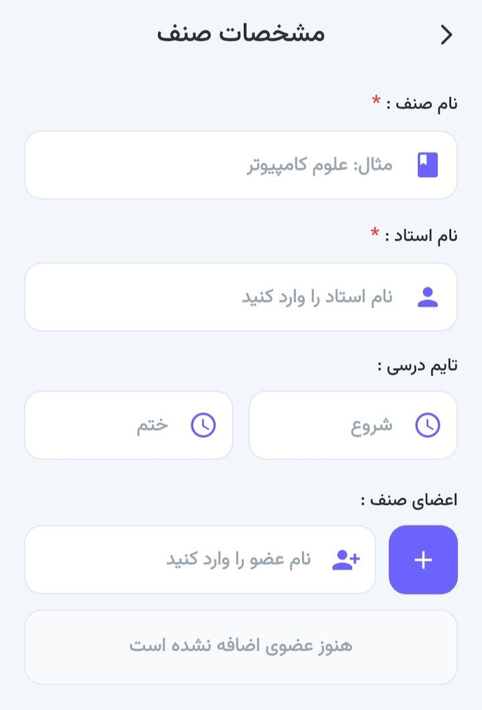
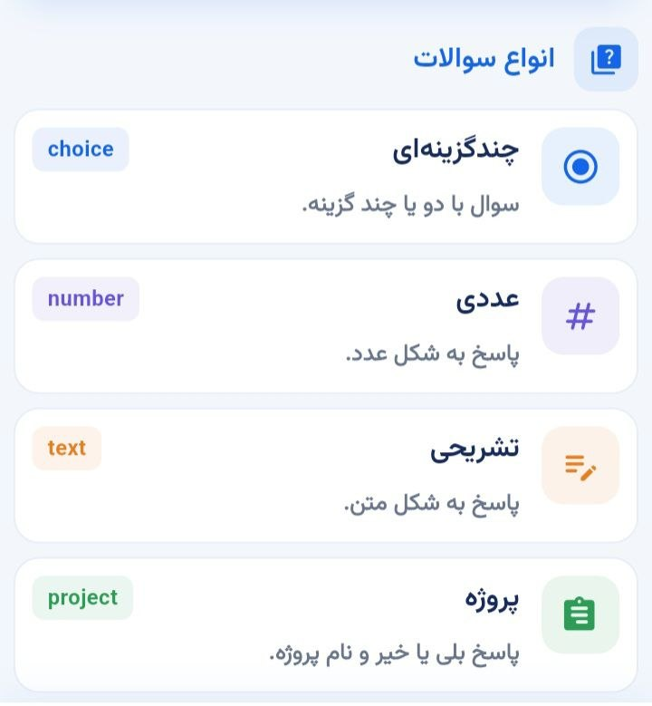

 
<div align="center">


# 🎓 EduExan

### Class Management & Student Evaluation System

**EduExan is an Android app for class administration, Excel-based questionnaires, and recording student evaluations.**

[](https://flutter.dev)
[](https://dart.dev)
[](https://github.com/ehnoori/EduExan)
[](https://github.com/ehnoori/EduExan)

[**GitHub Repository**](https://github.com/ehnoori/EduExan) · [**Report an Issue**](https://github.com/ehnoori/EduExan/issues)

</div>

---

## Contents

- [Overview](#overview)
- [Screenshots](#screenshots)
- [English Brochure](#english-brochure)
- [Features](#features)
- [Technology Stack](#technology-stack)
- [Getting Started](#getting-started)
- [Question File Format](#question-file-format)
- [Evaluation Workflow](#evaluation-workflow)
- [Project Structure](#project-structure)
- [Testing](#testing)
- [Developer](#developer)
- [License](#license)

---

## Overview

**EduExan** is a Flutter-based class management and student evaluation application. It helps teachers organize class rosters, prepare questionnaires from Excel files, record student answers, and export class results.

Application data is stored locally on the device. The current supported and documented target is Android; other platforms have not been verified.

## Screenshots

### Application Preview

<div align="center">

| Class Management | Class Details | Question Types | Excel Import Guide |
|:---:|:---:|:---:|:---:|
|  |  |  |  |

</div>

## English Brochure

The English brochure provides an overview of the app, its workflow, supported question types, and screenshots:

- [View the English brochure (HTML)](./EduExam-Brochure-English.html)
- [Download the English brochure (PDF)](./EduExam-Brochure-English.pdf)

---

## Features

### Class Management
- Create, view, edit, and delete classes.
- Record the class name and teacher; optionally add a start and end time.
- Add and remove students from each class.
- Prevent duplicate student names within the same class.

### Student Management
- View a class roster and select a student to evaluate.
- See which students are complete and which are still awaiting evaluation.
- Prevent a student from being evaluated more than once in a class.

### Questionnaire Management
- Import and keep multiple `.xlsx` question files on the device.
- Preview a question file before activating it.
- Choose which saved question file is used for new evaluations.
- Review the question count and delete saved question files.
- Read questions from the workbook's first worksheet.

### Supported Question Types
- `choice` — multiple-choice questions with at least two options.
- `number` — numeric answers.
- `text` — written answers.
- `project` — yes/no answers; choosing yes requires a project name.

### Student Evaluation
- Display one question at a time and allow moving between questions.
- Require an answer to every question before saving an evaluation.
- Save each evaluation with its answers, date, and a snapshot of the questions used.
- Keep previously saved evaluations unchanged when the active question file changes.
- Record responses; the app does not automatically grade answers.
- Prevent duplicate evaluations for the same student in a class.

### Results and Excel Files
- Generate a formatted Excel results workbook for a class after evaluations are recorded.
- Include class summary details, evaluation counts, date, student names, and recorded answers.
- Open, share, and delete generated Excel results from the app.

### Local Data and Interface
- Store classes, students, questions, and evaluations locally using Isar.
- Store imported questionnaire files and result workbooks in app document storage.
- Provide a Persian-language interface with Google Fonts typography.
- Include an in-app question-import guide and a sample Excel workbook viewer.

---

## Technology Stack

| Technology | Purpose |
|---|---|
| Flutter | Application framework |
| Dart | Programming language |
| Isar | Local database |
| Excel Plus | Reading and writing Excel workbooks |
| File Picker | Selecting questionnaire files |
| Path Provider | Application document storage |
| Shared Preferences | Onboarding state |
| Open Filex | Opening exported Excel files |
| Share Plus | Sharing exported files |
| Google Fonts | User-interface typography |
| Universal Document Viewer | Displaying the sample spreadsheet |

---

## Getting Started

### Prerequisites

Install the Flutter SDK and Android Studio (or another Flutter-compatible IDE), and set up an Android emulator or device.

### 1. Clone the Repository

```bash
git clone https://github.com/ehnoori/EduExan.git
```

### 2. Open the Project

```bash
cd EduExan
```

### 3. Install Dependencies

```bash
flutter pub get
```

### 4. Run the Application

```bash
flutter run
```

### 5. Analyze the Project

```bash
flutter analyze
```

---

## Question File Format

Import an `.xlsx` workbook with one question per row on the first worksheet. Each row must include a question and a correct or sample answer. Type and option columns depend on the question.

| Column | Required | Description |
|---|:---:|---|
| `Question` | Yes | Question text; Persian/Dari header aliases are supported. |
| `Type` | No | `choice`, `number`, `text`, or `project`. If blank, the question is treated as `text`. |
| `Option A` – `Option D` | For `choice` | At least two non-empty answer options are required. |
| `CorrectAnswer` | Yes | Correct or sample answer. For a choice question, use an option label such as `A`. |

Persian/Dari aliases are supported for the question, type, option, and answer headers. A sample workbook is available at [`assets/files/eduexam_sample_questions.xlsx`](./assets/files/eduexam_sample_questions.xlsx).

---

## Project Structure

The project separates app screens, Isar models and database access, and supporting services.

```text
EduExan/
│
├── android/
├── lib/
│   ├── database/
│   │   └── isar_service.dart
│   ├── models/
│   │   ├── class_model.dart
│   │   ├── evaluation_model.dart
│   │   └── question_model.dart
│   ├── screens/
│   │   ├── class_list_screen.dart
│   │   ├── class_management_screen.dart
│   │   ├── evaluation_screen.dart
│   │   ├── excel_files_screen.dart
│   │   ├── home_screen.dart
│   │   ├── import_questions_screen.dart
│   │   └── student_selection_screen.dart
│   ├── services/
│   │   ├── excel_export_service.dart
│   │   └── question_import_parser.dart
│   └── main.dart
├── assets/
│   ├── files/
│   └── images/
├── test/
├── pubspec.yaml
├── pubspec.lock
└── README.md
```

---

## Evaluation Workflow

1. Create a class and add its teacher and students.
2. Import an Excel questionnaire, preview it, and activate it.
3. Select a class and an unevaluated student.
4. Answer each question and save the evaluation.
5. Review the student's evaluation status and export the class results to Excel.
6. Open or share the generated workbook from the results screen.

Each evaluation saves its own question snapshot, preserving the question set used for that student. The active question file is used for each new evaluation; the app does not automatically lock one questionnaire for an entire class.

---

## Testing

Run the Flutter test suite:

```bash
flutter test
```

Analyze the project:

```bash
flutter analyze
```

---

## Contributing

Contributions, suggestions, and bug reports are welcome.

1. Fork the repository.
2. Create a feature branch.
3. Make your changes.
4. Test your changes.
5. Submit a Pull Request.

---

## Developer

**Hamed Noori**

- Flutter application developer
- GitHub: [@ehnoori](https://github.com/ehnoori)
- Project: [EduExan](https://github.com/ehnoori/EduExan)

---

## License

No license file is currently included in this repository. All rights are reserved unless a license is added.

---

<div align="center">

**Built with Flutter ❤️**

⭐ If you find EduExan useful, consider giving the repository a star!

[Back to Top](#-eduexan)

</div>
