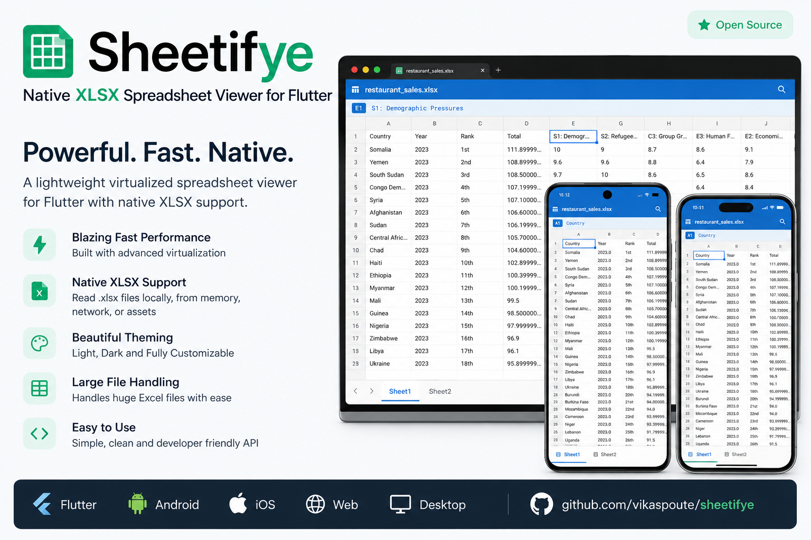

 
<div align="center">

# 🎓 EduExan

### Class Management & Student Evaluation System

**A Flutter application for managing classes, students, questionnaires, and student evaluations.**

[](https://flutter.dev)
[](https://dart.dev)
[](https://github.com/ehnoori/EduExan)
[](https://github.com/ehnoori/EduExan)

[**GitHub Repository**](https://github.com/ehnoori/EduExan) · [**Report an Issue**](https://github.com/ehnoori/EduExan/issues)

</div>

---

## 📖 Overview

**EduExan** is a Flutter-based class management and student evaluation system designed to simplify classroom administration and academic assessment.

The application provides tools for creating classes, managing students, importing questionnaires from Excel files, conducting structured student evaluations, and storing evaluation results.

EduExan uses a local database to preserve application data and provides a structured evaluation workflow that helps maintain consistency across student assessments.

## 📸 Screenshots

### Application Preview

<div align="center">

| Android | Application Graphics | iOS |
|:---:|:---:|:---:|
|  |  |  |

</div>

---

## ✨ Key Features

### 🏫 Class Management
- Create new classes.
- View and manage existing classes.
- Organize evaluation activities by class.
- Keep evaluation records associated with their classes.

### 👨‍🎓 Student Management
- Manage students within classes.
- Select students for evaluation.
- Organize student evaluation records.
- Prevent duplicate evaluations for the same student in a class.

### 📝 Student Evaluation
- Evaluate students using structured questionnaires.
- Display questions and their available answer options.
- Support different question types.
- Save completed evaluations.
- Retrieve and review previously saved results.

### 📊 Excel Question Import
- Import questionnaire files in `.xlsx` format.
- Support Persian question and column headers.
- Read multiple-choice questions and their options.
- Support question types:
  - `choice`
  - `number`
  - `text`
  - `project`
- Preview imported questions before saving.
- Manage imported questionnaire files.
- Store selected Excel files in application storage.

### 📚 Question Management
- Manage questionnaire files.
- View the number of questions in each file.
- Select an active questionnaire file.
- Preview imported questions.
- Delete unwanted questionnaire files.
- Maintain the currently selected question set.

### 🔒 Question Snapshot System
- Save a snapshot of the questions when the first evaluation in a class is submitted.
- Use the same question set for subsequent students in that class.
- Keep historical evaluation records independent of later question imports.
- Help ensure consistent assessment across students.

### 💾 Local Database
- Store classes and student information.
- Store questions and evaluation records.
- Preserve data locally using Isar.
- Retrieve previously saved records.
- Keep question snapshots associated with evaluation records.

### 📁 File Management
- Select Excel files from the device.
- Store imported files in application storage.
- Manage saved questionnaire files.
- Support file-related workflows implemented in the application.

### 🌐 User Interface
- Flutter-based user interface.
- Persian typography using Google Fonts.
- Support for Persian-language content.
- Organized screens for class management and student evaluation.

---

## 🛠️ Technology Stack

| Technology | Purpose |
|---|---|
| Flutter | Cross-platform application development |
| Dart | Main programming language |
| Isar Database | Local data persistence |
| Excel Plus | Excel file reading and processing |
| File Picker | Selecting files from the device |
| Path Provider | Application storage directories |
| Shared Preferences | Saving application settings |
| Google Fonts | Typography |
| Share Plus | Sharing content |
| Syncfusion PDF | PDF functionality |

---

## 📱 Supported Platforms

| Platform | Status |
|---|---|
| Android | Primary target |
| iOS | Flutter project platform |
| Windows | Flutter project platform |
| Linux | Flutter project platform |
| macOS | Flutter project platform |
| Web | Flutter project platform |

*Platform availability depends on the implementation and testing of individual features.*

---

## 🚀 Getting Started

### Prerequisites

Make sure you have installed:

- Flutter SDK
- Dart SDK
- Android Studio or Visual Studio Code
- An Android emulator or physical device

### 1. Clone the Repository

```bash
git clone https://github.com/ehnoori/EduExan.git
```

### 2. Open the Project

```bash
cd EduExan
```

### 3. Install Dependencies

```bash
flutter pub get
```

### 4. Run the Application

```bash
flutter run
```

### 5. Analyze the Project

```bash
flutter analyze
```

---

## 🧱 Project Structure

The project follows a modular Flutter structure, separating screens, database services, models, and application resources.

```text
EduExan/
│
├── android/
├── ios/
├── linux/
├── macos/
├── windows/
├── web/
│
├── lib/
│   ├── database/
│   │   └── isar_service.dart
│   │
│   ├── models/
│   │   ├── class_model.dart
│   │   ├── question_model.dart
│   │   └── evaluation_model.dart
│   │
│   ├── screens/
│   │
│   ├── widgets/
│   │
│   └── ...
│
├── assets/
│
├── screenshots/
│   ├── android.png
│   ├── graphic.png
│   └── ios.png
│
├── test/
│
├── pubspec.yaml
├── pubspec.lock
└── README.md
```

---

## 📚 Evaluation Workflow

EduExan follows a structured evaluation process:

1. Create a class.
2. Manage students in the class.
3. Import questions from an Excel file.
4. Preview and review imported questions.
5. Select the questionnaire for evaluation.
6. Select a class and a student.
7. Complete the evaluation questionnaire.
8. Save the evaluation result.
9. Review previously saved evaluations.

### Question Snapshot System

EduExan includes a question snapshot mechanism to maintain consistency during class evaluations.

When the first student in a class is evaluated, the current question set is saved as a snapshot.

Subsequent student evaluations in that class use the same snapshot, even if the active questionnaire is changed later.

This helps ensure that students in the same class are evaluated using a consistent set of questions.

---

## 📊 Excel Import Format

EduExan supports Excel question files with columns such as:

| Column | Description |
|---|---|
| سوال | Question text |
| نوع سوال | Question type |
| گزینه A | First option |
| گزینه B | Second option |
| گزینه C | Third option |
| گزینه D | Fourth option |
| پاسخ صحیح | Correct answer |

### Supported Question Types

- `choice` — Multiple-choice questions.
- `number` — Numeric questions.
- `text` — Text-based questions.
- `project` — Project-based questions.

The first worksheet is used for importing questions.

---

## 🔐 Data Persistence

EduExan uses Isar Database to store application data locally.

The application maintains data for:

- Classes
- Students
- Questions
- Questionnaire files
- Student evaluations
- Question snapshots

Importing a new questionnaire does not intentionally replace historical evaluation snapshots.

This helps preserve previously saved evaluation records.

---

## 🗺️ Roadmap

- [x] Class management foundation
- [x] Student evaluation workflow
- [x] Local database integration
- [x] Excel question import
- [x] Persian Excel header support
- [x] Multiple question types
- [x] Question preview
- [x] Question snapshot support
- [x] Questionnaire file management
- [ ] Improve reporting and analytics
- [ ] Expand PDF reporting features
- [ ] Improve backup and restore workflows
- [ ] Add additional data visualization features
- [ ] Further improve UI and usability

---

## 🧪 Testing

Run the Flutter test suite:

```bash
flutter test
```

Analyze the project:

```bash
flutter analyze
```

---

## 🤝 Contributing

Contributions, suggestions, and bug reports are welcome.

1. Fork the repository.
2. Create a feature branch.
3. Make your changes.
4. Test your changes.
5. Submit a Pull Request.

---

## 👨‍💻 Author

**Hamed Noori**

- GitHub: [@ehnoori](https://github.com/ehnoori)
- Project: [EduExan](https://github.com/ehnoori/EduExan)

---

## 📄 License

No license has been confirmed for this repository yet.

Add a `LICENSE` file if you intend to publish the project under an open-source license.

---

<div align="center">

**Built with Flutter ❤️**

⭐ If you find EduExan useful, consider giving the repository a star!

[Back to Top](#-eduexan)

</div>
